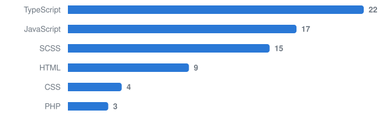

# Olá, eu sou o Luiz Ricardo 👋

Sou desenvolvedor front-end com formação em Design Gráfico. Hoje trabalho principalmente com **WordPress**, **Laravel** e **React**, criando interfaces intuitivas, rápidas e fáceis de manter. Atuo como freelancer e também como CLT em uma empresa privada de tecnologia.

## 🛠 Tecnologias

**No dia a dia**

**Também uso**

## ⭐ Destaques

- **[Zap Flutuante Pro](https://github.com/luuizz/zap-flutuante):** plugin WordPress de botão flutuante de WhatsApp, com painel em React e rastreio de UTM.
- **[WordPress Docker Boilerplate](https://github.com/luuizz/wordpress-docker-boilerplate):** stack Docker para iniciar projetos WordPress com PHP-FPM, Nginx e MariaDB.
- **[Tema Rankdone](https://github.com/luuizz/theme-rankdone):** tema WordPress feito do zero para o blog da Rankdone, com PHP, SCSS e Gulp.
- **[Portfólio](https://github.com/luuizz/luizricardo-portfolio):** [meu site pessoal](https://www.luizricardotech.com.br/), com Next.js, Tailwind CSS e GSAP.

## 🖥️ Projetos públicos

Lista atualizada automaticamente todos os dias, do projeto mais recente para o mais antigo.

<!-- projetos:inicio -->

<strong>WordPress</strong> · 5 projetos

| Projeto | Sobre | Stack | Demo | Atualizado |
| --- | --- | --- | --- | --- |
| [mv-slider-plugin](https://github.com/luuizz/mv-slider-plugin) | Plugin de slider para WordPress, com post type e shortcode próprios. | WordPress | — | fev/2026 |
| [frontdev-theme](https://github.com/luuizz/frontdev-theme) | Tema WordPress do FrontDev. | WordPress | — | fev/2026 |
| [zap-flutuante](https://github.com/luuizz/zap-flutuante) | Plugin de botão flutuante de WhatsApp, com painel em React e rastreio de UTM. | WordPress | — | fev/2026 |
| [wordpress-docker-boilerplate](https://github.com/luuizz/wordpress-docker-boilerplate) | Stack Docker para iniciar projetos WordPress com PHP-FPM, Nginx e MariaDB. | WordPress, Docker | — | out/2025 |
| [theme-rankdone](https://github.com/luuizz/theme-rankdone) | Tema WordPress do blog da Rankdone, com PHP, SCSS e Gulp. | WordPress, Sass, Gulp | — | ago/2024 |

<strong>React & Next.js</strong> · 30 projetos

| Projeto | Sobre | Stack | Demo | Atualizado |
| --- | --- | --- | --- | --- |
| [estudio-capim](https://github.com/luuizz/estudio-capim) | — | Next.js, TypeScript, GSAP | — | out/2026 |
| [luizricardo-portfolio](https://github.com/luuizz/luizricardo-portfolio) | Meu portfólio pessoal. | Next.js, TypeScript, Tailwind, GSAP | [Abrir](https://luizricardotech.vercel.app) | jun/2026 |
| [frontdev](https://github.com/luuizz/frontdev) | — | React, TypeScript | — | fev/2026 |
| [fintech](https://github.com/luuizz/fintech) | — | React, TypeScript, Sass | — | jun/2025 |
| [dogs-social](https://github.com/luuizz/dogs-social) | Projeto criado para poder explorar o framework do React. Neste projeto eu utilizo a API… | React, Sass | [Abrir](https://luric-dogs-social.netlify.app/) | mai/2025 |
| [kaechocolates-next](https://github.com/luuizz/kaechocolates-next) | — | Next.js, TypeScript | — | abr/2025 |

Ver mais 24

| Projeto | Sobre | Stack | Demo | Atualizado |
| --- | --- | --- | --- | --- |
| [zarrin-blog](https://github.com/luuizz/zarrin-blog) | — | Next.js, TypeScript, Tailwind | — | abr/2025 |
| [structboost-styled](https://github.com/luuizz/structboost-styled) | Projeto de estudo utilizando o styled-components para estilização de um… | Next.js | [Abrir](https://strucboost-styled.vercel.app/) | abr/2025 |
| [flowrise](https://github.com/luuizz/flowrise) | Projeto desenvolvido para a empresa Flowrise | Next.js, TypeScript, Tailwind | — | mar/2025 |
| [boilerplate-nextjs](https://github.com/luuizz/boilerplate-nextjs) | — | Next.js, TypeScript, Tailwind | — | fev/2025 |
| [kaechocolates](https://github.com/luuizz/kaechocolates) | — | Next.js, TypeScript, Tailwind | — | fev/2025 |
| [havana-portfolio](https://github.com/luuizz/havana-portfolio) | — | Next.js, TypeScript, Tailwind | — | jan/2025 |
| [alex-taylor](https://github.com/luuizz/alex-taylor) | — | Next.js, TypeScript, Tailwind | — | jan/2025 |
| [atlantic](https://github.com/luuizz/atlantic) | — | Next.js, TypeScript, Tailwind | — | jan/2025 |
| [hamilton-app](https://github.com/luuizz/hamilton-app) | — | Next.js, TypeScript, Tailwind | — | jan/2025 |
| [untittled-ui](https://github.com/luuizz/untittled-ui) | — | Next.js, TypeScript, Tailwind | — | jul/2024 |
| [blogboost-next](https://github.com/luuizz/blogboost-next) | — | Next.js | — | jun/2024 |
| [cloudboost-vanilla](https://github.com/luuizz/cloudboost-vanilla) | — | Next.js | [Abrir](https://cloudboost-vanilla.vercel.app) | jun/2024 |
| [structure-boost-vanilla](https://github.com/luuizz/structure-boost-vanilla) | Projeto desenvolvido  usando a API do vanilla-extract para fins de estudo. | Next.js | [Abrir](https://struct-vanilla.vercel.app/) | jun/2024 |
| [whatif-seasontwo](https://github.com/luuizz/whatif-seasontwo) | Projeto do curso Codeboost. Neste projeto está sendo feito com o framework de JS-in-CSS… | Next.js | [Abrir](https://whatif-seasontwo.vercel.app/) | jun/2024 |
| [awwards-lp](https://github.com/luuizz/awwards-lp) | — | Next.js, Sass, GSAP | — | mai/2024 |
| [gsap-effect-list](https://github.com/luuizz/gsap-effect-list) | — | Next.js | — | mai/2024 |
| [blogboost](https://github.com/luuizz/blogboost) | — | Next.js, Tailwind | — | mai/2024 |
| [glisten-two-ai](https://github.com/luuizz/glisten-two-ai) | — | Next.js, TypeScript, Tailwind, GSAP | [Abrir](https://glistenai-nu.vercel.app) | abr/2024 |
| [marvel-spiderman2](https://github.com/luuizz/marvel-spiderman2) | — | Next.js, Tailwind | — | dez/2023 |
| [styled-components](https://github.com/luuizz/styled-components) | — | Next.js | [Abrir](https://styled-components-omega-lyart.vercel.app) | nov/2023 |
| [case-study-itau](https://github.com/luuizz/case-study-itau) | — | Next.js, TypeScript, Tailwind | — | out/2023 |
| [ia-upload](https://github.com/luuizz/ia-upload) | Projeto realizado durante o evento da Rocketseat, onde está sendo construído uma… | React, TypeScript, Tailwind | — | set/2023 |
| [whatif-codeboost](https://github.com/luuizz/whatif-codeboost) | — | Next.js, TypeScript | — | set/2023 |
| [bizzgu](https://github.com/luuizz/bizzgu) | Projeto destinado as aulas da Coderhouse. Neste projeto será construído o front-end de… | React | [Abrir](https://loja-bizzgu.netlify.app/) | set/2023 |

<strong>Angular</strong> · 5 projetos

| Projeto | Sobre | Stack | Demo | Atualizado |
| --- | --- | --- | --- | --- |
| [turbocloud](https://github.com/luuizz/turbocloud) | — | Angular, TypeScript, Tailwind | — | jul/2025 |
| [pokeapi-boost](https://github.com/luuizz/pokeapi-boost) | — | Angular, TypeScript | [Abrir](https://pokeapi-boost.vercel.app) | jun/2025 |
| [blogboost-angular](https://github.com/luuizz/blogboost-angular) | Projeto dedicado ao Blogboost, nele estou explorando e conhecendo mais sobre as… | Angular, TypeScript, Sass | [Abrir](https://blogboost-angular.vercel.app/) | mai/2025 |
| [kaechocolates-angular](https://github.com/luuizz/kaechocolates-angular) | — | Angular, TypeScript | — | abr/2025 |
| [structureboost-angular](https://github.com/luuizz/structureboost-angular) | Primeiro projeto iniciado em Angular, com o layout do structureboost | Angular, TypeScript | [Abrir](https://structureboost-angular-ivory.vercel.app/) | jan/2024 |

<strong>Node.js</strong> · 1 projeto

| Projeto | Sobre | Stack | Demo | Atualizado |
| --- | --- | --- | --- | --- |
| [orbit](https://github.com/luuizz/orbit) | API com Fastify, Drizzle ORM e PostgreSQL. | Fastify, TypeScript, Docker | — | nov/2025 |

<strong>HTML, CSS & PHP</strong> · 30 projetos

| Projeto | Sobre | Stack | Demo | Atualizado |
| --- | --- | --- | --- | --- |
| [delavie](https://github.com/luuizz/delavie) | — | Sass, Gulp | — | nov/2025 |
| [rcc-construtora](https://github.com/luuizz/rcc-construtora) | — | Sass, Gulp | — | out/2025 |
| [granviver](https://github.com/luuizz/granviver) | — | Sass, Gulp | — | ago/2025 |
| [gulp-php](https://github.com/luuizz/gulp-php) | — | Sass, Gulp | — | ago/2025 |
| [estudo-node](https://github.com/luuizz/estudo-node) | Projeto realizado durante o curso da Dio.me, nele eu pratico os fundamentos do Node.js e… | JavaScript | — | jun/2025 |
| [wildbeast](https://github.com/luuizz/wildbeast) | — | Sass | — | jun/2025 |

Ver mais 24

| Projeto | Sobre | Stack | Demo | Atualizado |
| --- | --- | --- | --- | --- |
| [template-gmail](https://github.com/luuizz/template-gmail) | — | HTML | [Abrir](https://luuizz.github.io/template-gmail/) | jan/2025 |
| [forest](https://github.com/luuizz/forest) | Forest - Site oficial da empresa que conecta pessoas à natureza, oferecendo estadias e… | Tailwind | [Abrir](https://forest-ten-psi.vercel.app/) | jan/2025 |
| [aula-boost](https://github.com/luuizz/aula-boost) | Projeto desenvolvido durante a aula do Codeboost. | Sass, Gulp | [Abrir](https://teslabot-mocha.vercel.app/) | nov/2024 |
| [transition-home](https://github.com/luuizz/transition-home) | — | HTML | [Abrir](https://luuizz.github.io/transition-home/) | nov/2024 |
| [doctocare-vite](https://github.com/luuizz/doctocare-vite) | — | TypeScript, Sass | — | set/2024 |
| [bankboost](https://github.com/luuizz/bankboost) | Projeto do curso Codeboost, com o boilerplate do Vite | TypeScript, Sass | [Abrir](https://bankboost.netlify.app/) | ago/2024 |
| [luiz-ricardo-dsgn](https://github.com/luuizz/luiz-ricardo-dsgn) | — | Sass, Gulp | [Abrir](https://luuizz.github.io/luiz-ricardo-dsgn/) | mai/2024 |
| [figpro](https://github.com/luuizz/figpro) | Projeto realizado durante as aulas do curso Codeboost. Neste projeto está sendo… | Sass, Gulp | [Abrir](https://figpro-codeboost.netlify.app/) | mar/2024 |
| [blog-rankdone](https://github.com/luuizz/blog-rankdone) | Blog criado para a empresa Rankdone | Sass, Gulp | [Abrir](https://blog-rankdone.netlify.app/) | mar/2024 |
| [uiboost](https://github.com/luuizz/uiboost) | — | Sass, Gulp | — | fev/2024 |
| [jedai-template](https://github.com/luuizz/jedai-template) | Repositório criado para o template do jedai | HTML | [Abrir](https://luuizz.github.io/jedai-template/) | jan/2024 |
| [cloudboost](https://github.com/luuizz/cloudboost) | Projeto de estudo desenvolvido na atualização do Codeboost, focado no aprimoramento das… | Sass | [Abrir](https://luuizz.github.io/cloudboost/) | out/2023 |
| [superget-lp](https://github.com/luuizz/superget-lp) | Projeto destinado ao desenvolvimento de uma hero section para a landing page da SuperGet. | Sass | [Abrir](https://luuizz.github.io/superget-lp/) | set/2023 |
| [projeto-blizzard](https://github.com/luuizz/projeto-blizzard) | Projeto feito para uma landing page da Blizzard, neste projeto é trabalhado o front-end… | Sass, Gulp | [Abrir](https://luuizz.github.io/projeto-blizzard/) | ago/2023 |
| [poke-api](https://github.com/luuizz/poke-api) | Projeto destinado a criação de um sistema de consultas dos Pokemons usando a API pública… | Sass, Gulp | [Abrir](https://luuizz.github.io/poke-api/) | mai/2023 |
| [nlw-explorer](https://github.com/luuizz/nlw-explorer) | Projeto feito durante a décima segunda edição do NLW Explorer. Nele foi desenvolvido uma… | Sass, Gulp | [Abrir](https://luuizz.github.io/nlw-explorer/) | mai/2023 |
| [projeto-starwars](https://github.com/luuizz/projeto-starwars) | Projeto final proporcionado pela Coderhouse com o intuito de praticar todos os… | HTML | [Abrir](https://luuizz.github.io/projeto-starwars/) | mai/2023 |
| [landing-page-neon](https://github.com/luuizz/landing-page-neon) | Projeto feito para uma landing page da Neon, desafio proporcionado pelo curso Codeboost.… | Sass | [Abrir](https://luuizz.github.io/landing-page-neon/) | mai/2023 |
| [projeto-kinghost](https://github.com/luuizz/projeto-kinghost) | Projeto feito para uma landing page da Kinghost, utilizando o pré-processador de CSS… | Sass | [Abrir](https://luuizz.github.io/projeto-kinghost/) | abr/2023 |
| [projeto-wireframe](https://github.com/luuizz/projeto-wireframe) | Projeto Wireframe do curso Codeboost, proporcionado pelo Will Moreira. O projeto consiste… | CSS | [Abrir](https://luuizz.github.io/projeto-wireframe/) | abr/2023 |
| [beautysaloon](https://github.com/luuizz/beautysaloon) | — | HTML | — | fev/2023 |
| [rocketnews](https://github.com/luuizz/rocketnews) | Projeto de estudo proporcionado pela Rocketseat | CSS | — | fev/2023 |
| [Desafio-Social-Three](https://github.com/luuizz/Desafio-Social-Three) | Desafio proposto pela rocketseat para criar uma página de links utilizável. | HTML | — | fev/2023 |
| [desafio-final-sw](https://github.com/luuizz/desafio-final-sw) | Desafio do curso de desenvolvimento Web da Coderhouse, nele trabalhamos em um site… | HTML | — | jan/2023 |

<!-- projetos:fim -->

## 📊 Linguagens

Linguagem principal dos meus repositórios públicos.

<!-- linguagens:inicio -->

<!-- linguagens:fim -->
